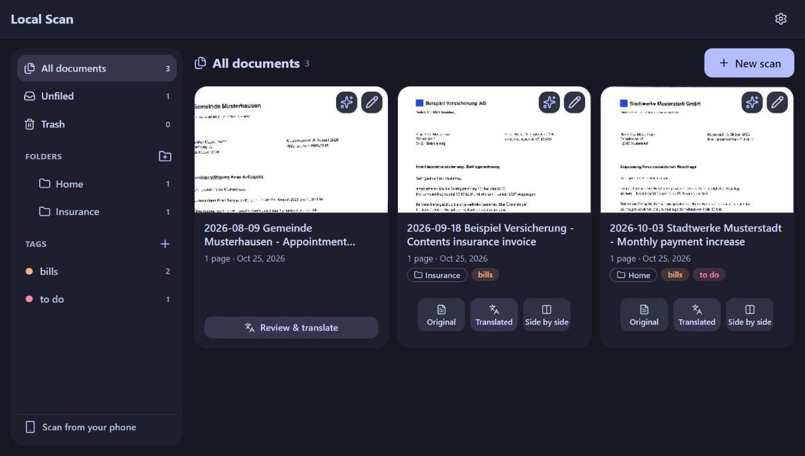
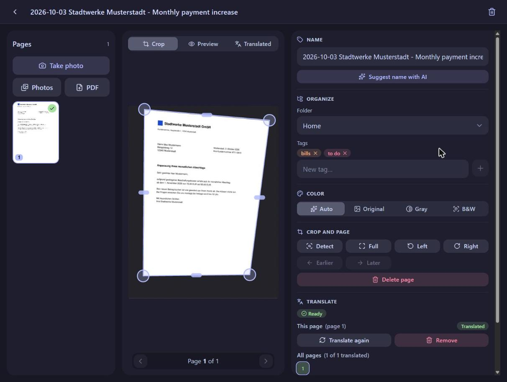
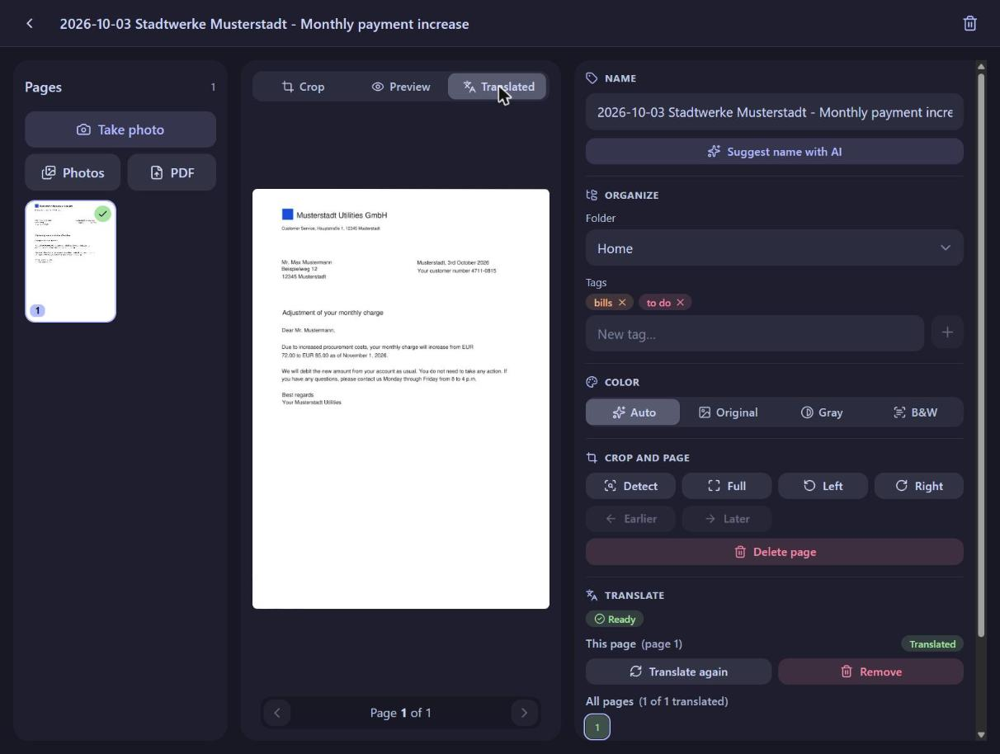
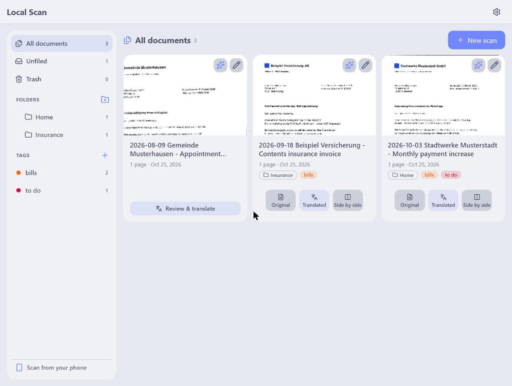
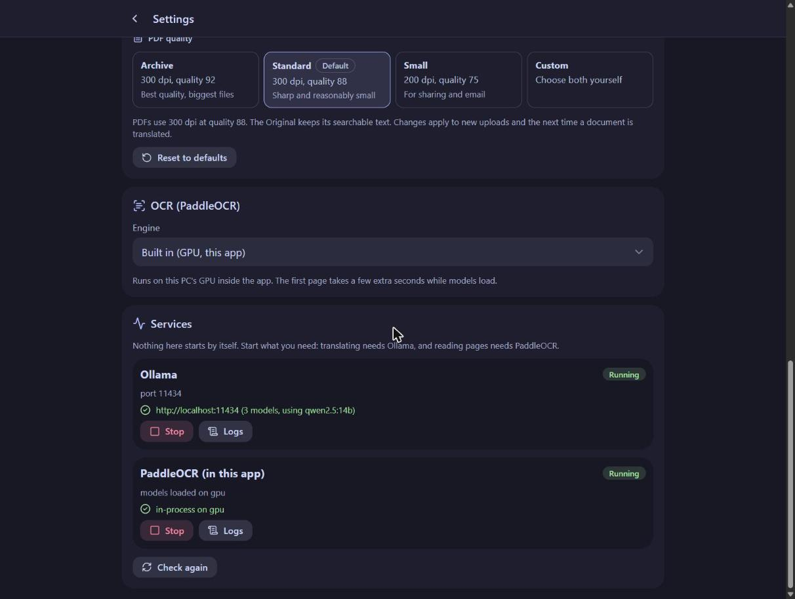

# Local Scan

A fully offline replacement for "Adobe Scan, then Google Translate". Photograph a letter on your phone, drag
the four corners to fix the crop, and get three PDFs back. Nothing leaves your PC.



| PDF | What it is |
| --- | --- |
| **Original** | the cleaned scan, with a searchable text layer |
| **Translated** | same layout, logos, stamps and signatures, with the text replaced by its translation |
| **Side by side** | original and translation next to each other |

Each opens in a new browser tab. OCR runs on the GPU with PaddleOCR (in-process by default) and translation on
your local Ollama. German to English is the default pair; Settings lets you pick others.

All the letters in the screenshots are made up (`scripts/demo_library.py`).

## Run

```bat
run.bat
```

This starts the server hidden and puts an icon in the system tray (open the app, copy the phone link, start with
Windows, open the log folder, restart, exit). Open `http://localhost:8010` on the PC, or the phone link from the
tray menu (same Wi-Fi). `run.bat -Console` runs the server in the window instead and prints the link and a QR code.

Needs `uv`, Node and Ollama. The first run installs everything, including PaddleOCR GPU
(`uv sync --extra paddle`). The first page after a start takes about a minute while the OCR models warm up on the
GPU; after that a page takes well under a second.

Port 8010 is used because `Projects/Paddle/start_server.bat` takes 8000 and kills anything else on it.

### GPU note (RTX 50xx)

Paddle must be the **CUDA 12.9** build (`paddle-cu129` index in `pyproject.toml`). The cu126 build loads on a
Blackwell card but returns garbage text. Paddle's Windows wheel doesn't declare its CUDA DLL packages, so the
`paddle` extra lists the `nvidia-*-cu12` wheels explicitly.

## Using it

1. **New scan**, then **Take photo** for each page, **Photos** for several at once, or **PDF** to import an
   existing scan or a digital PDF.
2. Corners are found automatically. Drag them, or the edge bars, to adjust; a magnifier shows the detail. Rotate,
   reorder and pick a color (Auto, Original, Gray, B&W) per page. **Preview** shows the result.
3. **Translate** one page or all of them. The **Translated** tab shows the result page by page, and the three PDFs
   appear when every page is done.





Changing a page and translating again only reruns OCR for the changed pages, and translations are cached per
paragraph, so adding a page never retranslates the others.

Beyond scanning:

- **Folders, tags and a trash** (30 days) to organize the library; drag tiles onto folders.
- **Suggest name with AI** reads every page and proposes `<date> <sender> - <subject>`. It only runs when you click.
- **Sort with AI** splits a batch of photos into documents and puts their pages in order, without a model by default.
- **Move pages** to a new document from the right-click menu on a thumbnail.
- **Photo and PDF quality** presets (Settings > Photos & PDFs); uploads keep the phone's JPEG byte for byte by default.
- **Looks:** four Catppuccin flavors, twelve accents and three corner radii, plus text size, all in Settings.



## Settings and services

Settings holds the languages, the Ollama model, photo and PDF quality, the OCR engine and the look. The
**Services** card at the bottom starts, stops, health-checks and shows the logs of Ollama and PaddleOCR, so you
never need another window. Nothing starts by itself; a service runs only after you click Start.



## Configuration

`config.toml` holds the defaults. Changes made on the Settings page are stored in `data/settings.json`.

OCR engines:
- `paddle_local` (default): PaddleOCR inside this app on the GPU, using the models in `~/.paddlex`
- `paddle_http`: an OCR server. `ocr.paddle_http.request` selects the format: `multipart` (the
  `Projects/Paddle` server), `paddlex` (PaddleX serving) or `paddlehub` (PaddleHub serving). To start it from
  Settings, set `services.paddle_server` (`python` and `cwd`) in `config.toml`.

## Layout

```
backend/app/
  scan/       corner detection, perspective correction (with real aspect ratio recovery), filters
  ocr/        OcrEngine protocol, PaddleOCR local and HTTP, line -> paragraph grouping, PDF text layer import
  translate/  Translator protocol, Ollama implementation
  render/     text erasing and the three PDFs (PyMuPDF)
  ai/         naming, page sorting
  api/        FastAPI routes
  jobs.py     background worker
  services.py start, stop and watch Ollama and PaddleOCR
frontend/     React + Vite + Tailwind v4, the cuppa-ui kit in ui/, screens in src/
scripts/      tray icon, QR code, demo library for screenshots
data/         documents (gitignored)
```

Adding another OCR or translation engine means one class implementing the protocol in `ocr/base.py` or
`translate/base.py`, plus a line in that package's `registry.py`.

## Develop

```bat
uv run pytest               # backend tests
run.bat -Dev                # backend reload + Vite on :5173
```

To retake the screenshots, run a second instance on its own data and fill it with made-up letters:

```powershell
$env:LOCALSCAN_DATA_DIR = "$env:TEMP\localscan-demo"
uv run --extra paddle --directory backend uvicorn app.main:app --port 8011
uv run python scripts/demo_library.py http://localhost:8011
```
